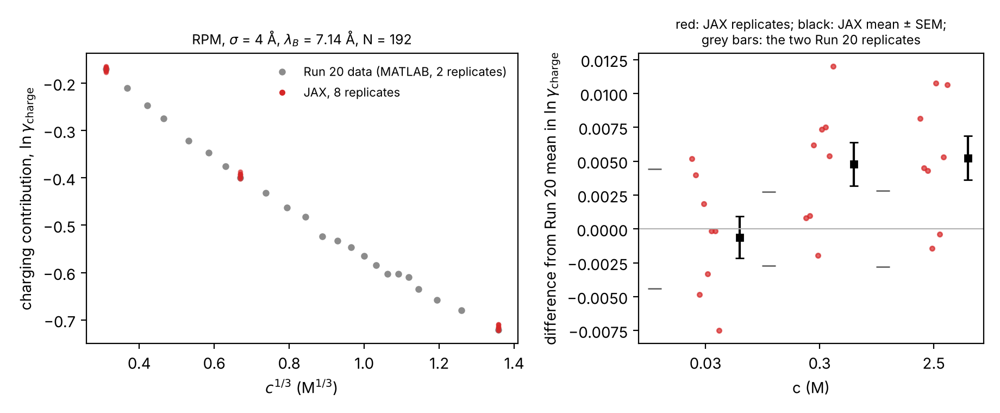

# rpm-mc-jax


Monte Carlo simulation of the **restricted primitive model (RPM) electrolyte** with periodic Ewald summation and
thermodynamic integration of the ion-pair charging free energy, written as a transparent **NumPy reference** and a
**JAX implementation** (jit-compiled, replicas vectorised with `vmap`). It reproduces the published simulation data of
Nordstrand (2026), doi [10.17632/hkr6jbkypg.1](https://doi.org/10.17632/hkr6jbkypg.1), which were produced with MATLAB
on a SLURM cluster.

## Validation against published data

N = 192 ions, sigma = 4 A, lambda_B = 7.14 A, production-length sampling (2500 / 1500 / 1500 / 12000 sweeps).
`ln gamma_charge = beta*DeltaF/2` is the electrostatic charging contribution to the mean ionic activity coefficient.

| c (M) | JAX, mean +/- SEM of 8 replicates | MATLAB data (Run 20, 2 replicates) | difference | combined uncertainty |
|---|---|---|---|---|
| 0.03 | -0.1705 +/- 0.0015 | -0.1699 | -0.0006 | -0.2 sigma |
| 0.3 | -0.3947 +/- 0.0016 | -0.3995 | +0.0048 | +1.3 sigma |
| 2.5 | -0.7155 +/- 0.0016 | -0.7207 | +0.0052 | +1.5 sigma |



The replicate-to-replicate scatter (0.0044-0.0046) is the same at all three states and matches the scatter of the two
original replicates. The comparison is limited by the reference having only two replicates (uncertainty of its mean
about 0.003), so offsets of up to about 0.005 (1% of the value) cannot be excluded. Details, short-run results and the
NumPy-reference runs are in [`validation/README.md`](validation/README.md); the reference values are in
`validation/reference_run20_baseline.csv` (CC BY 4.0, from the dataset above).

Speed on one CPU core including compilation: 8 replicas of a production-length state take 17-19 minutes with JAX
(about 2.2 minutes per replica); the NumPy reference needs 11-20 minutes per replica.

## Quick start

```bash
pip install -e ".[jax,test]"
python -m pytest            # 18 tests
```

```python
from rpm_mc.jaxmc.ti import ti_batch

# four independent replicas in one compiled, vectorised call (short settings; omit them for production length)
out = ti_batch(0.3, seeds=[1, 2, 3, 4], N=192,
               host_equil=300, pair_equil=150, win_equil=150, win_prod=1200, sample_every=10)
print(out["ln_gamma_charge"], out["ln_gamma_charge_sem"])
```

Container: `docker build -t rpm-mc-jax . && docker run --rm rpm-mc-jax` runs the test suite.

## What is where

| Path | Contents |
|---|---|
| `src/rpm_mc/reference/` | NumPy reference: Ewald energy (`ewald.py`), Metropolis moves and thermodynamic integration (`mc.py`) |
| `src/rpm_mc/jaxmc/` | JAX implementation mirroring the reference function by function (`core.py`), vmapped TI driver (`ti.py`) |
| `tests/` | 18 tests: Madelung constant, independence of the Ewald splitting parameter, incremental move energies, exact dU/dlambda against finite differences and `jax.grad`, hard-core and structure-factor invariants, lambda = 0 window, JAX against NumPy |
| `validation/` | Scripts, stored results, comparison with the dataset, figure, SLURM job scripts |

## Method in brief

Reduced units (sigma = 1, kT = 1, Gamma = lambda_B/sigma), cubic periodic box, equal hard spheres of charge +/-1.
Ewald splitting alpha = 5/L, half-space reciprocal vectors up to 4, minimum-image real space to L/2 (error against a
converged sum: about 1e-5 kT per ion in the energy, below 1e-3 kT per single-ion move). N host ions plus an inserted
pair with charges +/-lambda; six coupling windows 0, 0.2, ..., 1; mixed local/global single-ion Metropolis moves with
step adaptation; exact Ewald dU/dlambda sampled every 10 sweeps; Delta F by the trapezoid rule.

JAX helps with replica-level parallelism (`vmap`), compilation of the move loop (`lax.scan`) and checking the analytic
derivative by automatic differentiation. Single-ion Metropolis moves are inherently sequential, so the gain comes from
compilation and replicas, not from parallelising one chain.

## Limitations

Cubic box, single-ion moves, minimum-image real-space cutoff, windows run sequentially. Validated only for the
baseline state (sigma = 4 A, lambda_B = 7.14 A, N = 192) at three concentrations. Not a general-purpose MD or MC package.

## Citation and licence

See `CITATION.cff`. MIT licence for the code; the reference data in `validation/` are CC BY 4.0 (Nordstrand 2026).
Developed with AI assistance (Claude, Anthropic); correctness rests on the tests and on the agreement with
independently generated simulation data shown above.
